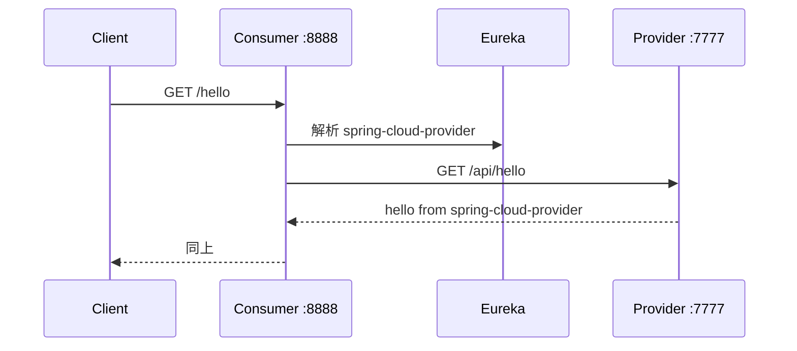

# 第 02 课 · Eureka 入门

## 学习目标

- 理解微服务为什么要**服务注册与发现**
- 能启动 Eureka Server，并让 Provider、Consumer **注册到注册中心**
- 看懂 `spring.application.name` 与 `eureka.client.serviceUrl.defaultZone` 的作用
- 用 **`@LoadBalanced RestTemplate`** 按服务名从 Consumer 调用 Provider（本课最小示例）

## 本课讲什么

这是 Spring Cloud 的**最小闭环**：一个注册中心、Provider 暴露简单 REST 接口、Consumer 通过 Eureka **服务名**调用 Provider。先建立「服务名 ↔ 实例地址」在 Eureka 控制台里的直观印象，再体验一次注册发现 + 负载均衡客户端。

## 模块结构

| 模块 | 默认端口 | 角色 |
|------|----------|------|
| `spring-cloud-02-service` | 8761 | Eureka Server |
| `spring-cloud-02-provider` | 7777 | 服务提供者（客户端） |
| `spring-cloud-02-consumer` | 8888 | 服务消费者（客户端） |

## 核心功能

1. **注册中心**：不注册自己、不拉取别人，只维护注册表。
2. **Provider / Consumer**：启动后向 Eureka 上报本机 IP 与端口，服务名分别为 `spring-cloud-provider`、`spring-cloud-consumer`。
3. **跨服务调用**：Consumer `GET /hello` → RestTemplate 请求 `http://spring-cloud-provider/api/hello` → Provider 返回文本。

## 跨服务调用说明

本课在「只注册」之外增加了 **Consumer → Provider** 的最小 HTTP 调用，代码位置如下：

| 端 | 类 | 接口 |
|----|-----|------|
| Provider | `spring-cloud-02-provider/.../controller/HelloController.java` | `GET /api/hello` → 返回 `hello from spring-cloud-provider` |
| Consumer | `SpringCloud02ConsumerApplication` | 声明 `@LoadBalanced RestTemplate` Bean |
| Consumer | `spring-cloud-02-consumer/.../controller/HelloController.java` | `GET /hello` → 通过 RestTemplate 访问 Provider |

Consumer 里 RestTemplate 使用的 URL 主机名是 **`spring-cloud-provider`**（与 `spring.application.name` 一致），**不是** `localhost:7777`。LoadBalancer 会从 Eureka 拉取该服务名下的实例列表，再选一个发起 HTTP 请求；本课只有一个 Provider 实例，主要体会「按服务名调用」这一习惯。

### 调用链



## 如何实现

- **Server**：`@EnableEurekaServer`（见 `SpringCloud02ServiceApplication`）
- **Client**：`@EnableDiscoveryClient`（见 Provider / Consumer 启动类）
- **调用**：Consumer 中 `@LoadBalanced RestTemplate` + `HelloController`；Provider 中 `HelloController`（`/api/hello`）
- **依赖**：Server 使用 `spring-cloud-starter-netflix-eureka-server`；Client 使用 `spring-cloud-starter-netflix-eureka-client` + `spring-cloud-starter-loadbalancer`（为后续 RestTemplate 负载均衡做准备）

**关键配置（service）**：

```properties
eureka.client.register-with-eureka=false
eureka.client.fetch-registry=false
```

**关键配置（provider/consumer）**：

```properties
eureka.client.serviceUrl.defaultZone=http://localhost:8761/eureka/
```

## 建议启动与验证

1. 启动 `spring-cloud-02-service`
2. 启动 `spring-cloud-02-provider`、`spring-cloud-02-consumer`
3. 浏览器打开 `http://localhost:8761`，在 Eureka 界面应看到两个应用实例
4. 验证调用：
   - 经 Consumer（走注册发现）：`curl http://localhost:8888/hello` → 应返回 `hello from spring-cloud-provider`
   - 直连 Provider（不经过 Eureka 解析）：`curl http://localhost:7777/api/hello` → 同上文本

## 与后续课程

- **第 04 课**：在 Eureka 上增加 Actuator、实例 ID、续约参数等运维向配置。
- **第 06 课**：在同样思路下扩展为 **User** 接口、多 Provider 实例与负载均衡观察。

## Docker 一键启动

本课已提供 **Docker Compose**，无需本地安装 JDK/Maven 即可启动演示（首次会镜像内 Maven 编译，耗时较长）。

```bash
cd spring-cloud-02
docker compose up --build -d
```

- 查看日志：`docker compose logs -f`
- 停止：`docker compose down -v`
- 验证：Eureka 控制台 http://localhost:8761 应看到 provider 与 consumer；`curl http://localhost:8888/hello` 应经由 Consumer 调到 Provider

> 容器内已通过环境变量将 Eureka 地址改为 `eureka`（或第 05 课集群 hostname），并开启 `prefer-ip-address` 以便服务间调用。
