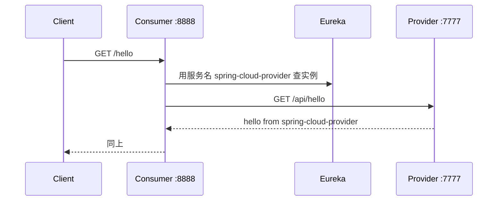

# 第 02 课 · Eureka 入门

## 一句话先懂

单体应用里，A 调 B 只要写死 `localhost:7777`。拆成微服务后，B 可能有多台、端口还会变。**Eureka 就是一本自动更新的通讯录**：服务启动时登记自己的地址，调用方按**服务名**查地址，再发 HTTP。

## 学习目标

- 能讲清为什么微服务需要**服务注册与发现**
- 能启动 Eureka Server，并让 Provider、Consumer 出现在控制台
- 看懂 `spring.application.name` 和 `eureka.client.serviceUrl.defaultZone`
- 用 `@LoadBalanced RestTemplate` 按服务名从 Consumer 调用 Provider

## 本课在整条链路里的位置

这是整门课的**最小闭环**：注册中心 + 提供者 + 消费者 + 一次按服务名的 HTTP 调用。后面所有课（集群、负载、Feign、网关、Nacos）都建立在「通讯录」这个模型上。

---

## 知识点讲解

### 1. 服务注册与发现：不要把 IP 写死在代码里

**是什么**

- **注册**：服务启动后，向注册中心上报「我叫什么、IP 是多少、端口是多少」
- **发现**：调用方不写死 IP，只写服务名；由客户端向注册中心要一份列表，再选一台去调

**有什么用**

机器会扩缩容、容器 IP 会变。写死 `192.168.1.10:7777` 意味着每次变更都改代码、重新发布。通讯录模式把「地址变化」从代码里抽走。

**生活类比**

公司总机：你不记每个工位的分机号，只说「转技术部」；前台查当下谁在岗，再帮你转过去。

### 2. Eureka Server 与 Eureka Client

**是什么**

| 角色 | 本课模块 | 注解 | 干什么 |
|------|----------|------|--------|
| Server | `spring-cloud-02-service` | `@EnableEurekaServer` | 守着通讯录，提供网页控制台 |
| Client | Provider / Consumer | `@EnableDiscoveryClient` | 向 Server 登记自己，并（可选）拉取别人的地址 |

Eureka 是 **Netflix 开源、Spring Cloud 封装**的注册中心。本仓库 02～23 课用它；25 课起用 Nacos，模型一样，换了一家实现。

**有什么用**

没有 Server，客户端无处报名；没有 Client，Server 只是空壳。两者缺一不可。

### 3. `spring.application.name`：通讯录上的「部门名」

**是什么**

逻辑服务名。同一名字的多台机器，在 Eureka 里归为**同一个应用**下的多个实例。

**有什么用**

Consumer 写 URL 时用的主机名必须和它一致。本课 Provider 叫 `spring-cloud-provider`，所以调用写成：

```text
http://spring-cloud-provider/api/hello
```

而不是 `http://localhost:7777/api/hello`。

名字写错，LoadBalancer 会报 `No instances available for xxx`。

### 4. `defaultZone`：客户端去哪报到

**是什么**

```properties
eureka.client.serviceUrl.defaultZone=http://localhost:8761/eureka/
```

这是 Eureka Server 的入口地址。**最后的 `/eureka/` 是固定后缀**，去掉会注册失败。

**有什么用**

Client 启动后按这个 URL 发送注册和心跳。第 05 课会变成「带账号的 URL」和「多个 Server 地址用逗号隔开」。

### 5. Server 为什么不注册自己、不拉别人

**本课 Server 配置**

```properties
eureka.client.register-with-eureka=false
eureka.client.fetch-registry=false
```

**是什么 / 有什么用**

Eureka Server 源码里也带着一份 Client。单节点时如果再「向自己注册、再拉一份注册表」，没有收益，还会在控制台上看到 Server 自己，容易干扰初学者。所以单机教学默认关掉。第 05 课做集群时，节点之间要互相同步，规则会不一样。

### 6. `@LoadBalanced RestTemplate`：按服务名发 HTTP

**是什么**

`RestTemplate` 是 Spring 里发 HTTP 的工具。加上 `@LoadBalanced` 后，它不再把 URL 里的主机名当 DNS 域名，而是当 **Eureka 服务名**：先查本地缓存的实例列表，挑一台，再真正发起请求。

**有什么用**

调用方代码只认服务名。以后 Provider 从 1 台变成 3 台、端口从 7777 换成随机端口，Consumer **不用改这一行 URL**。

本课只有 1 个 Provider，负载均衡「选哪一台」还不明显，重点是养成「写服务名」的习惯。多实例在第 06 课。

---

## 模块结构

| 模块 | 默认端口 | 角色 |
|------|----------|------|
| `spring-cloud-02-service` | 8761 | Eureka Server |
| `spring-cloud-02-provider` | 7777 | 服务提供者 |
| `spring-cloud-02-consumer` | 8888 | 服务消费者 |

## 跨服务调用

| 端 | 类 | 接口 |
|----|-----|------|
| Provider | `HelloController` | `GET /api/hello` → `hello from spring-cloud-provider` |
| Consumer | `SpringCloud02ConsumerApplication` | 声明 `@LoadBalanced RestTemplate` |
| Consumer | `HelloController` | `GET /hello` → 用 RestTemplate 访问 Provider |

### 调用链



## 如何实现

- Server：`@EnableEurekaServer`
- Client：`@EnableDiscoveryClient`
- 依赖：Server 用 `spring-cloud-starter-netflix-eureka-server`；Client 用 `eureka-client` + `spring-cloud-starter-loadbalancer`

## 建议启动与验证

1. 启动 `spring-cloud-02-service` → Provider → Consumer
2. 打开 [http://localhost:8761](http://localhost:8761)，应看到两个应用
3. 验证调用：
   - 走注册发现：`curl http://localhost:8888/hello`
   - 直连 Provider（不经过 Eureka 解析）：`curl http://localhost:7777/api/hello`
4. 两个请求都应返回 `hello from spring-cloud-provider`

刚启动就立刻 curl Consumer，可能遇到 `No instances available for spring-cloud-provider`：注册和拉取需要几秒，等控制台上出现 Provider 再试。

## 与后续课程

- **第 04 课**：租约、自我保护、instanceId、Actuator——通讯录的「运行细节」
- **第 06 课**：三个同名 Provider，观察负载均衡真正把请求分到不同机器

## Docker 一键启动

```bash
cd spring-cloud-02
docker compose up --build -d
```

- 日志：`docker compose logs -f`
- 停止：`docker compose down -v`
- 验证：控制台 [http://localhost:8761](http://localhost:8761)；等健康检查通过后再 `curl http://localhost:8888/hello`

> 容器内 Eureka 地址改成主机名 `eureka`，并开启 `prefer-ip-address`，否则容器之间按 `localhost` 会连错。
