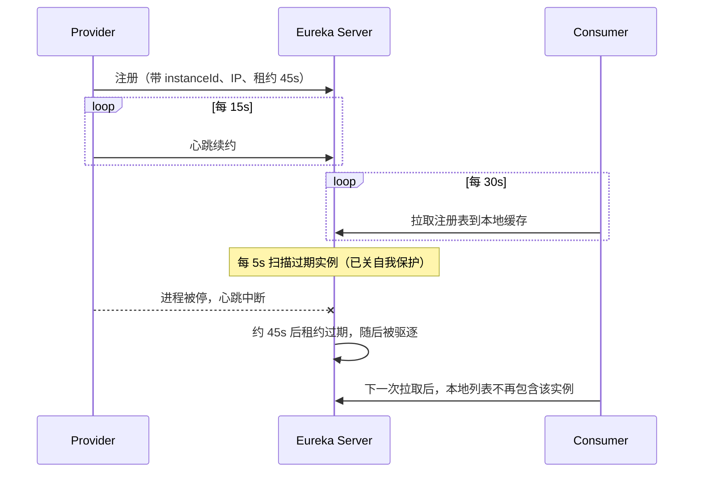

# 第 04 课 · Eureka 进阶与 Actuator

## 一句话先懂

第 02 课解决的是「服务怎么找得到彼此」。本课解决的是：**找到之后，注册中心怎么判断实例还活着、下线要等多久、控制台里看到的 IP / 实例名从哪来、运维页怎么挂上去。**

可以把它想成：02 课是「办了一本通讯录」；04 课是「规定大家多久打一次卡、多久没打卡就除名、名片上写姓名还是写手机号」。

## 学习目标

- 能用自己的话讲清：**自我保护、驱逐、租约（续约 / 过期）、拉取注册表**分别管什么
- 知道 **instanceId、prefer-ip-address** 为什么会影响「别人怎么连你」
- 理解 **Actuator** 是运维探针，不是业务接口
- 能对照本课配置，在 Eureka 控制台看懂实例的 IP、端口、状态页链接

## 本课在整条链路里的位置

| 课 | 你已经会 / 本课新增 |
|----|---------------------|
| 第 02 课 | 有 Eureka，Provider / Consumer 能注册；Consumer 还能按服务名调一次 `/hello` |
| **本课** | **不讲新的业务调用**。把注册中心和实例的「运行参数」摊开看 |
| 第 05 课 | 给 Eureka 加账号密码，并做成三节点集群 |

本课 **没有** Consumer 调用 Provider 的业务代码。打开 Consumer 的 `8888` 端口，不会看到 02 课那种 `/hello`。重点全部在配置和 Eureka 控制台。

## 模块结构

| 模块 | 默认端口 | 角色 |
|------|----------|------|
| `spring-cloud-04-service` | 8761 | Eureka Server（注册中心） |
| `spring-cloud-04-provider` | 7777 | 只注册，不提供教学用业务接口 |
| `spring-cloud-04-consumer` | 8888 | 只注册，不调用 Provider |

启动类仍是 `@EnableEurekaServer` / `@EnableDiscoveryClient`，和 02 课一样。变化几乎全在 `application.properties`。

---

## 知识点讲解

下面每个词都按「是什么 → 有什么用 → 本课怎么配」来讲。看完再去对配置，就不会只剩一串英文键名。

### 1. 租约（Lease）：实例向注册中心「续命」

**是什么**

实例注册到 Eureka 时，不是「登记一次就永远在册」，而是领了一张**有期限的租约**。客户端必须定期发心跳说「我还活着」，这叫**续约（renew）**。超过约定时间没续约，注册中心就认为它死了，这叫**过期（expire）**。

**有什么用**

微服务进程随时可能崩溃、被杀掉、机器宕机。注册中心不能靠人工维护花名册，只能靠这套「心跳 + 超时」自动更新。Consumer 拿到的实例列表，才会尽量接近真实情况。

**生活类比**

健身房会员卡：你定期刷卡续费（续约）；超过宽限期没刷，会员资格取消（过期剔除）。刷卡太勤会增加前台负担，太久不刷又会把还在锻炼的人误删。

**本课配置（Provider / Consumer）**

```properties
# 默认 30 秒续约一次，本课改成 15 秒：实验时更快看到心跳
eureka.instance.lease-renewal-interval-in-seconds=15

# 默认 90 秒没心跳就过期，本课改成 45 秒：停掉进程后更快从列表消失
eureka.instance.lease-expiration-duration-in-seconds=45
```

经验值：过期时间通常是续约间隔的 2～3 倍，避免偶发网络抖动就误踢。生产环境不要为了「看起来灵敏」把这两个值改得过小，心跳风暴和误踢都会出问题。

### 2. 拉取注册表（registry-fetch-interval）：客户端多久抄一次通讯录

**是什么**

Eureka 是 **客户端发现**：Consumer 不会每次调用都去问 Server「Provider 在哪」。它会把注册表**缓存到本地**，隔一段时间再拉一次全量/增量更新。

**有什么用**

调用路径短、注册中心压力小。代价是：刚上线或刚下线的实例，客户端可能要等一个拉取周期才能感知。

**本课配置**

```properties
# 默认 60 秒拉一次，本课 30 秒，实验时更容易观察到「列表变了」
eureka.client.registry-fetch-interval-seconds=30
```

和「租约」的分工：

| 配置 | 谁在动 | 管什么 |
|------|--------|--------|
| `lease-renewal-*` / `lease-expiration-*` | 实例 → Server | Server 花名册准不准 |
| `registry-fetch-interval-seconds` | 客户端 ← Server | 客户端本地缓存新不新 |

### 3. 自我保护（Self Preservation）：宁可留着「可能已死」的人，也不清空花名册

**是什么**

Eureka Server 会统计：最近一分钟，正常续约的比例够不够。如果**大量实例同时**停心跳，它更倾向于判断「是网络分区 / 注册中心自己有问题」，而不是「全世界的服务同时挂了」。于是进入**自我保护**：暂时**不再剔除**过期实例。

**有什么用**

生产环境里，一次机房抖动或 Eureka 所在网段故障，若立刻把所有实例踢掉，所有 Consumer 会同时找不到人，比「暂时调用到几个其实已挂的实例」更惨。自我保护是在「脏数据」和「空花名册」之间，选择前者。

**为什么本课要关掉**

本地学习时你常常只起 1～2 个实例。你停掉 Provider，本来希望控制台马上少一行；若自我保护开着，可能等很久都还挂在上面，看起来像「配置没生效」。所以本课：

```properties
eureka.server.enable-self-preservation=false
```

**记住**：这是**实验开关**。生产集群不要随便关。

### 4. 驱逐间隔（eviction-interval）：扫墓的频率

**是什么**

就算租约已经过期，Eureka 也不是「刚过期那一毫秒」立刻删人，而是有一个后台定时任务，每隔一段时间扫描一次过期实例并移除。这个间隔就是 `eviction-interval-timer-in-ms`。

**有什么用**

控制「死人」在花名册上最多还能躺多久。默认 60000（60 秒）。本课改成 5 秒，方便你：停掉一个进程 → 最多再等几秒 → 控制台刷新后实例消失。

```properties
eureka.server.eviction-interval-timer-in-ms=5000
```

三个「快慢」叠在一起，才决定你实验时的体感：

```
客户端停心跳
  → 等过期（本课 45s）
  → 等下一次驱逐扫描（本课最多 5s）
  → Server 花名册更新
  → 再等客户端拉取（本课最多 30s）
  → Consumer 才不再打到这台机器
```

所以「我都停了进程，对方怎么还在调？」往往不是 LoadBalancer 坏了，而是这条时间链还没走完。

### 5. instanceId：同一服务名下，怎么区分「第几台」

**是什么**

`spring.application.name` 是**逻辑服务名**（比如都叫 `spring-cloud-provider`）。真正在 Eureka 里当主键用的，是 **instanceId**。默认经常是 `主机名:应用名:端口`。同一台机器、同一个端口再启一次，就会撞 ID。

**有什么用**

多实例、随机端口、Docker 里主机名都叫 `localhost` 时，没有唯一 instanceId，后注册的会把先注册的**覆盖掉**，控制台只剩一台，负载均衡也只看得到一台。

**本课配置**

```properties
eureka.instance.instanceId=${spring.application.name}:${random.value}
```

`${random.value}` 每次启动生成一段随机串，保证「同名服务、多进程」也能并排出现。第 06、17 课你会更明显地用到这一点。

### 6. prefer-ip-address：名片上写 IP，还是写主机名

**是什么**

实例注册时要告诉别人「请访问我的这个地址」。默认可能登记 **hostname**（如 `DESKTOP-XXX`、容器里的随机主机名）。对方按这个名字做 DNS 解析，局域网或 Docker 网桥里经常解析失败。

`prefer-ip-address=true` 的意思是：**优先把本机 IP 写进注册表**，别人直接打 IP:端口。

**有什么用**

容器互访、多网卡、hosts 没配齐时，这是最常见的「Eureka 里看得到，一调用就连不上」的解药。本课 Docker Compose 也强制开了它。

```properties
eureka.instance.prefer-ip-address=true
```

### 7. datacenter / environment：控制台上的环境标签

**是什么**

Eureka 控制台页眉会显示数据中心、环境名。它们**不参与选实例、不做路由**，只是运维标识，方便一眼看出「这是哪套环境的注册中心」。

**本课配置（Server）**

```properties
eureka.environment=dev
eureka.datacenter=roncoo
```

打开 `http://localhost:8761`，页面上方能看到这两个字样。

### 8. Actuator：给进程开一扇「体检窗」

**是什么**

`spring-boot-starter-actuator` 是 Spring Boot 的**运维端点**套件。业务代码继续提供 `/api/...`；Actuator 另外提供 `/actuator/health`、`/actuator/info` 这类**给机器和运维看**的接口：活着吗、版本是什么、构建号是多少。

**有什么用**

- 注册中心、K8s、监控系统要探活，不能靠猜业务接口
- Eureka 控制台点实例名时，会跳到你配置的**状态页**
- 后面第 18 课会把它当作监控体系的起点

**本课怎么配**

Provider / Consumer 的 POM 加了 Actuator。配置里用 Maven 占位符把构建信息写进 `info.*`：

```properties
info.build.name=@project.name@
info.build.groupId=@project.groupId@
info.build.artifact=@project.artifactId@
info.build.version=@project.version@

# 告诉 Eureka：点我的实例时，去打开这个路径当状态页
eureka.instance.status-page-url-path=/info
```

`@project.name@` 这类写法会在 **Maven 打包** 时替换成 POM 里的真实坐标。用 IDE 直接 Run 主类时，有时还是字面量 `@project.name@`，这是过滤未发生，不是 Actuator 坏了。

**和 Spring Boot 3 的路径差异（重要）**

原视频基于很老的 Boot，状态页常写 `/info`。当前工程是 **Boot 3**：Actuator 默认挂在 `/actuator` 下，且默认往往只暴露 `health`。所以：

| 你想看的 | 更可能生效的地址 |
|----------|------------------|
| 探活 | `http://localhost:7777/actuator/health` |
| 构建信息 | 需暴露 `info` 后访问 `http://localhost:7777/actuator/info` |
| Eureka 点实例跳转 | 本课写的是 `/info`；若 404，把 `status-page-url-path` 改成 `/actuator/info`，并增加 `management.endpoints.web.exposure.include=health,info` |

本课刻意保留原课程的 `/info` 键，方便对照视频；**先建立「状态页 = 运维信息」的概念**，路径以你本地实际能打开的为准。

### 9. 本课里的 Security 类：为第 05 课埋伏笔

`spring-cloud-04-service` 已经有 `EurekaSecurityConfiguration`（全路径 HTTP Basic、关掉 CSRF），POM 也引了 `spring-boot-starter-security`。但 **`application.properties` 里还没有写死用户名密码**。

含义：

- **Docker Compose**：用环境变量注入了 `roncoo` / `123456`，所以容器里打开控制台要登录
- **本地 IDE 直接启动**：Spring Security 可能在日志里打印一串**随机密码**，用 `user` + 该密码登录

第 05 课才会把「账号写进配置 + 客户端 URL 里带用户名密码 + 三节点互相认证」讲完整。本课不必深挖认证，知道「控制台突然要密码」从哪来即可。

---

## 这些参数在一次生命周期里怎么配合



---

## 如何实现（对照代码）

- Server：`ServiceApplication` + `@EnableEurekaServer`
- Client：Provider / Consumer 的 `@EnableDiscoveryClient`
- Server 调参：`eureka.server.enable-self-preservation`、`eviction-interval-timer-in-ms`、`eureka.datacenter` / `environment`
- Client 调参：`instanceId`、`prefer-ip-address`、租约、拉取间隔、`status-page-url-path`
- POM：Provider / Consumer 增加 `spring-boot-starter-actuator`（以及 `devtools`，改代码自动重启，与本课知识点无关）

## 建议启动与验证

1. 先启动 `spring-cloud-04-service`，再启动 Provider、Consumer
2. 打开 [http://localhost:8761](http://localhost:8761)
   - 页眉应能看到 `roncoo` / `dev`
   - 应用列表里有 `SPRING-CLOUD-PROVIDER`、`SPRING-CLOUD-CONSUMER`
   - 实例列应是 **IP:端口**（`prefer-ip-address`），instanceId 带一段随机串
3. 试探活：`curl http://localhost:7777/actuator/health`（Consumer 换 8888）
4. **观察剔除**：停掉 Provider 进程，大约 45～50 秒后再刷新控制台，该实例应消失（因为关了自我保护且驱逐间隔很短）
5. 再启动 Provider，刷新后应重新出现，且 instanceId 和上次不同（`random.value`）

## 与后续课程

- **第 05 课**：给控制台加固定账号，并把三个 Eureka 节点连成集群（高可用）
- **第 06 课**：才重新认真做 Consumer → Provider 的 REST 调用和多实例负载
- **第 18 课**：把 Actuator 当作监控体系再讲一遍（health 等端点）

## Docker 一键启动

本课已提供 Docker Compose，无需本地安装 JDK/Maven（首次会在镜像内 Maven 编译，耗时较长）。

```bash
cd spring-cloud-04
docker compose up --build -d
```

- 查看日志：`docker compose logs -f`
- 停止：`docker compose down -v`
- 验证：Eureka [http://localhost:8761](http://localhost:8761) 应看到 provider、consumer
- 控制台账号：`roncoo` / `123456`（仅 Compose 环境写死了账号；本地 IDE 启动请看上一节 Security 说明）

> 容器内已通过环境变量把 Eureka 地址改成 `eureka` 主机名，并开启 `prefer-ip-address`，方便容器之间互访。
